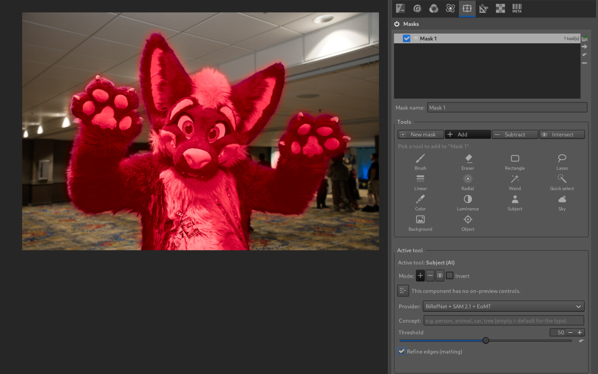
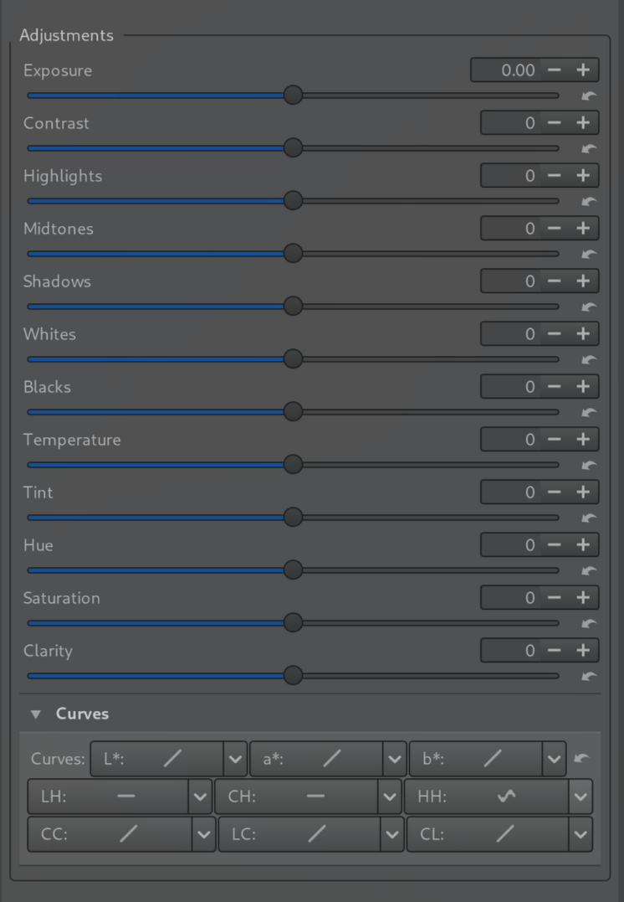

<picture>
  <source media="(prefers-color-scheme: dark)" srcset="https://raw.githubusercontent.com/RawTherapee/RawTherapee/dev/rtdata/images/rt-logo-text-white.svg">
  <source media="(prefers-color-scheme: light)" srcset="https://raw.githubusercontent.com/RawTherapee/RawTherapee/dev/rtdata/images/rt-logo-text-black.svg">
  
</picture>

## About this fork: Masks (TL;DR)

This fork adds a **Masks** tool: Lightroom-style local adjustments. It is the first tool in the Selective Editing tab. Everything else is the same as upstream RawTherapee.

  
  

- **Masks as layers:** each mask has its own adjustments. You draw on a mask with tools from a palette of icons, and the preview updates live as you draw. Nothing is applied destructively.
- **Drawing tools:** Brush, Eraser, Rectangle, Lasso, Linear gradient, Radial gradient, Magic wand, Quick select (a brush that grows over similar, connected pixels), Color range and Luminance range.
- **Subject, Sky, Background and Object masks:** these come from a subject detection model run by an optional local Python helper; see [`rtdata/segmentation/README.md`](rtdata/segmentation/README.md). Without the helper these four tools are greyed out.
- **Combining:** each tool adds to, subtracts from or intersects with the mask. Each mask can also be inverted, feathered, expanded or contracted, smoothed, and given an overall opacity. A red overlay shows the mask.
- **Per-mask adjustments:**
  - Sliders: Exposure, Contrast, Highlights, Midtones, Shadows, Whites, Blacks, Temperature, Tint, Hue, Saturation and Clarity.
  - Curves: the nine L\*a\*b\* curves (L, a, b, CC, CH, LH, HH, LC, CL).
- **Masks stay attached to the image:** they follow rotation, flips, distortion and perspective correction. They also render the same at any size, in the preview, in exports, in batch processing and on thumbnails.
- **Saved in the `.pp3`:** masks are stored in the processing profile under a `[Masking]` section. Upstream RawTherapee ignores that section.
- **Smaller changes:**
  - Middle-mouse-button panning in the preview.
  - Thread-safety fixes for the histogram and for reading processing parameters.
  - Packaging scripts for a Linux AppImage and a portable Windows build (see [`packaging/README.md`](packaging/README.md)). Ready-made packages are on the [Releases](https://github.com/bealsbe/RawTherapee/releases) page.

RawTherapee is a powerful, cross-platform raw photo processing program, released as [libre software](https://en.wikipedia.org/wiki/Free_software) under the [GNU General Public License Version 3](https://opensource.org/licenses/gpl-3.0.html). It is written mostly in C++ using a [GTK+](https://www.gtk.org) front-end. It uses a patched version of [dcraw](https://www.dechifro.org/dcraw/) for reading raw files, with an in-house solution which adds the highest quality support for certain camera models unsupported by dcraw and enhances the accuracy of certain raw files already supported by dcraw. It is notable for the advanced control it gives the user over the demosaicing and development process.

## Target Audience

RawTherapee is designed for developing raw files from a broad range of digital cameras, as well as [HDR DNG](https://helpx.adobe.com/photoshop/digital-negative.html) files and non-raw image formats ([JPEG](https://en.wikipedia.org/wiki/JPEG), [TIFF](https://en.wikipedia.org/wiki/Tagged_Image_File_Format) and [PNG](https://en.wikipedia.org/wiki/Portable_Network_Graphics)). The target audience ranges from enthusiast newcomers who wish to broaden their understanding of how digital imaging works to semi-professional photographers. Knowledge in color science is not compulsory, but it is recommended that you are eager to learn and ready to read our documentation ([RawPedia](https://rawpedia.rawtherapee.com/)) as well as look up basic concepts which lie outside the scope of RawPedia, such as [color balance](https://en.wikipedia.org/wiki/Color_balance), elsewhere.

Professionals may use RawTherapee as well while enjoying complete freedom, but will probably lack some peripheral features such as [Digital Asset Management](https://en.wikipedia.org/wiki/Digital_asset_management), printing, uploading, etc. RawTherapee is not aimed at being an inclusive all-in-one program, and the [open-source community](https://en.wikipedia.org/wiki/Open-source_movement) is sufficiently developed by now to offer all those peripheral features in other specialized software.

## Links

Website:
https://www.rawtherapee.com/

Forum:
https://discuss.pixls.us/c/software/rawtherapee

Features:
https://rawpedia.rawtherapee.com/Features

Documentation:
https://rawpedia.rawtherapee.com/

Download RawTherapee:
https://www.rawtherapee.com/downloads

Download source code tarballs:
https://www.rawtherapee.com/shared/source/

## Compilation, Branches and Git
Refer to RawPedia for a detailed explanation of how to get the necessary dependencies and how to compile RawTherapee.

Linux:
https://rawpedia.rawtherapee.com/Linux

Windows:
https://rawpedia.rawtherapee.com/Windows

macOS:
https://rawpedia.rawtherapee.com/macOS
